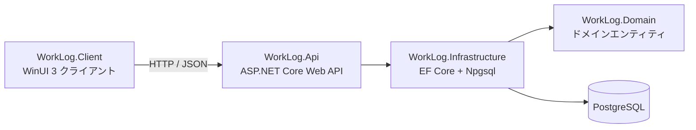

# WorkLog

作業時間を記録・集計するためのデスクトップアプリです。WinUI 3 クライアントから ASP.NET Core Web API を経由して PostgreSQL に保存する 3 層構成で、**学習目的で作成していますが、実用に耐える構成を目指しています**。

> [!NOTE]
> このリポジトリは学習用サンプルです。本番運用する場合は、認証・認可、HTTPS 証明書、バックアップ、ログの秘匿設定などを追加してください。

## 現状のステータス

| 領域 | 状態 | 備考 |
| --- | --- | --- |
| プロジェクト構成（Client / Api / Infrastructure / Domain） | ✅ 実装済み | 4 プロジェクト + `Directory.Packages.props` によるバージョン一元管理 |
| Web API のホスト構成 | ✅ 実装済み | Controllers + OpenAPI + Npgsql 接続の DI 登録まで |
| ドメインエンティティ | 🟡 途中 | `WorkLog.Domain` に `Project` / `WorkLogEntry` を追加。まだ `DbContext` には未接続 |
| データベースモデル | ⬜ 未実装 | `WorkLogDbContext` は空の実装 |
| EF Core マイグレーション | ⬜ 未実装 | 下記「マイグレーション」参照 |
| 作業時間の記録機能 | ⬜ 未実装 | Client は WinUI テンプレートのサンプル（カウンター）のみ |
| 集計・レポート機能 | ⬜ 未実装 | |
| 認証・認可 | ⬜ 未実装 | |
| テスト | ⬜ 未整備 | |

## 機能

### 実装済み

- WinUI 3 によるデスクトップ UI の雛形（`WorkLog.Client/`）
- ASP.NET Core Web API のホスト（Controllers + OpenAPI、Development で `/openapi/v1.json`）
- PostgreSQL 向け EF Core プロバイダの初期設定（`AddInfrastructure()`）

### 計画（TODO）

- [ ] 作業ログの CRUD（プロジェクト / タスク / 開始・終了時刻 / メモ）
- [ ] 日次・週次・月次の集計ビュー
- [ ] 分類別（タグ・プロジェクト別）の工数集計
- [ ] CSV / JSON でのエクスポート
- [ ] オフライン編集と同期
- [ ] 認証（ユーザー単位的数据分離）
- [ ] テスト（単体 + API 統合）

## アーキテクチャ



| プロジェクト | 種別 | 役割 |
| --- | --- | --- |
| `WorkLog.Client/` | WinUI 3 アプリ | UI と ViewModel。HTTP クライアントのみを持ち、DB には直接接続しない |
| `WorkLog.Api/` | ASP.NET Core Web API | HTTP エンドポイント、認証・認可、入力検証 |
| `WorkLog.Infrastructure/` | クラスライブラリ | `DbContext`、EF Core マッピング、リポジトリ、`AddInfrastructure()` |
| `WorkLog.Domain/` | クラスライブラリ | ドメインエンティティ（`Project` / `WorkLogEntry`）。EF Core や ASP.NET への依存を持たない純粋な層 |

> [!IMPORTANT]
> EF Core と Npgsql は **Infrastructure に閉じ込めてください**。Client は Release で `PublishTrimmed=True` が有効になっており、リフレクションを多用する EF Core を Client に載せるのは推奨されません。

## 技術スタック

| 区分 | 技術 | バージョン |
| --- | --- | --- |
| クライアント TFM | `net10.0-windows10.0.26100.0`（最小 `10.0.17763.0`） | .NET 10 |
| API / Infrastructure TFM | `net10.0` | .NET 10 |
| UI フレームワーク | WinUI 3（Windows App SDK） | 2.6.5 |
| MVVM | CommunityToolkit.Mvvm | 8.4.2 |
| O/R マッパー | Entity Framework Core | 10.0.15 |
| DB プロバイダ | Npgsql.EntityFrameworkCore.PostgreSQL | 10.0.3 |
| OpenAPI | Microsoft.AspNetCore.OpenApi | 10.0.15 |
| DI 抽象 | Microsoft.Extensions.DependencyInjection.Abstractions | 10.0.15 |
| データベース | PostgreSQL | <!-- TODO: 対象バージョンを決める（例: 16 / 17） --> |

バージョンはすべて [`Directory.Packages.props`](Directory.Packages.props) で一元管理しています。

## 必須環境

- [.NET 10 SDK](https://dotnet.microsoft.com/download/dotnet/10.0)
- Visual Studio 2022 以降 + **ASP.NET and web development** および **.NET Desktop Development** ワークロード
- **Windows SDK `10.0.26100.0`**（Visual Studio Installer の「個別のコンポーネント」タブで導入）
  - クライアントの `TargetPlatformVersion` と同じメジャーバージョンが必要です。未導入または断片インストールの状態だと、MSIX パッケージ生成が「指定されたモジュールが見つかりません」で失敗します（下記「解決済みの問題」参照）
- Windows 10 バージョン 1809（ビルド 17763）以降
- PostgreSQL サーバー（ローカル開発用で可）

## クイックスタート

### 1. 依存関係の復元

```powershell
dotnet restore WorkLog.slnx
```

### 2. 接続文字列の設定

認証情報はリポジトリにコミットせず、User Secrets または環境変数で設定してください。

```powershell
# API プロジェクトで User Secrets を初期化（初回のみ）
dotnet user-secrets init --project WorkLog.Api

# 接続文字列を設定
dotnet user-secrets set "ConnectionStrings:WorkLog" "Host=localhost;Port=5432;Database=worklog;Username=<user>;Password=<password>" --project WorkLog.Api
```

環境変数で代用する場合:

```powershell
$env:ConnectionStrings__WorkLog = "Host=localhost;Port=5432;Database=worklog;Username=<user>;Password=<password>"
```

接続文字列が未設定のまま API を起動すると、`ConnectionStrings:WorkLog` が不足している旨の例外で即座に失敗します。

### 3. API の起動

```powershell
dotnet run --project WorkLog.Api
```

- 既定の起動 URL: `https://localhost:54386` / `http://localhost:54387`（`WorkLog.Api/Properties/launchSettings.json`）
- Development 環境では OpenAPI ドキュメントが `https://localhost:54386/openapi/v1.json` で参照できます

詳細は [WorkLog.Api/README.md](WorkLog.Api/README.md) を参照してください。

### 4. クライアントの起動

Visual Studio で `WorkLog.Client` をスタートアッププロジェクトに設定して F5、または:

```powershell
dotnet run --project WorkLog.Client
```

## マイグレーション

EF Core のマイグレーションには、**起動プロジェクト（`WorkLog.Api`）に `Microsoft.EntityFrameworkCore.Design` への参照が必要**です。現状 `WorkLog.Api.csproj` は未参照のため、初回は 1 行追加してください。

```xml
<!-- WorkLog.Api/WorkLog.Api.csproj -->
<ItemGroup>
  <PackageReference Include="Microsoft.EntityFrameworkCore.Design">
	<PrivateAssets>all</PrivateAssets>
	<IncludeAssets>runtime; build; native; contentfiles; analyzers; buildtransitive</IncludeAssets>
  </PackageReference>
</ItemGroup>
```

ツールは EF Core と同じ系列のバージョンに固定します。

```powershell
dotnet tool install --global dotnet-ef --version 10.0.15

# 初期マイグレーションの作成
dotnet ef migrations add InitialCreate `
  --project WorkLog.Infrastructure `
  --startup-project WorkLog.Api

# 適用
dotnet ef database update `
  --project WorkLog.Infrastructure `
  --startup-project WorkLog.Api
```

## ビルド

```powershell
dotnet build WorkLog.slnx
```

### 動作確認済みのコマンド

```powershell
# MSIX パッケージ生成を含むフルビルド（成功を確認済み）
dotnet build WorkLog.slnx -p:Platform=x64
```

> [!NOTE]
> クライアントは `Platforms` が `x86;x64;ARM64` で RID がプラットフォームに紐付くため、`restore` と `build` で `-p:Platform` を一致させてください。既定（x86）で復元した後に `-p:Platform=x64` でビルドすると `NETSDK1047` になります。

### 既知の問題

| 事象 | 内容 | 回避策 / 状態 |
| --- | --- | --- |
| `MVVMTK0045`（警告 2 件） | `[ObservableProperty]` が WinRT の AOT シナリオで非対応 | WinUI 3 では partial プロパティへ移行することが MVVM Toolkit のドキュメントで推奨されている。**未対応** |

### 解決済みの問題

#### `APPX0002` / `MSB4018`（2026-11-18 解決）

MSIX パッケージ生成タスク `WinAppSdkGenerateAppxPackageRecipe` が `Win32Exception (0x80004005)`（`ERROR_MOD_NOT_FOUND`）で失敗していました。

原因は **Windows SDK のバージョン不一致**です。MSIX ビルドツール（`Microsoft.Build.Msix.MrmSupportLibraryResourceIndexMap`）は、MSBuild プロパティ `MrmSupportLibraryPath` が指す NuGet 上の `Microsoft.Windows.SDK.BuildTools` の DLL を使わず、インストール済み Windows SDK からパスを組み直して読み込みます。

```csharp
// GetLocation() が返すパスに差し替えられてから LoadLibraryW される
Path.Combine(<SDK Path>, "bin", <SDK が選ぶ最新 UAP ターゲットバージョン>, <アーキテクチャ>, "MrmSupport.dll")
```

この環境では Windows SDK が断片化してインストールされており、SDK 側が選ぶバージョン（`10.0.14393.0`）の `bin\x64\` に `MrmSupport.dll` が存在しなかったためロードに失敗していました。NuGet の `Microsoft.Windows.SDK.BuildTools` のバージョンが原因ではありません（その DLL 自体は正常にロードできます）。

**対処**: Visual Studio Installer の「個別のコンポーネント」から **Windows SDK `10.0.26100.0`** を導入し、PC を再起動しました。以降は `-p:EnableMsixTooling=false` を付けずにビルドできます。

```powershell
# SDK のバージョン付き bin に MrmSupport.dll があるかの確認
Get-ChildItem "${env:ProgramFiles(x86)}\Windows Kits\10\bin" -Filter MrmSupport.dll -Recurse |
  Select-Object -ExpandProperty FullName
```

## パッケージバージョン管理の方針

- すべてのバージョンは `Directory.Packages.props`（Central Package Management）で管理し、`.csproj` には `Version` 属性を書きません。
- **EF Core / Npgsql は .NET 10 対応版にピン留めしています**（EF Core `10.0.15`、Npgsql `10.0.3`）。nuget.org 上の最新安定版は EF Core `11.0.0` ですが、**EF Core 11 は `net11.0` 専用アセットのため .NET 10 では使用できません**。
- Npgsql プロバイダは EF Core を `[10.0.4, 11.0.0)` の範囲で要求するため、EF Core を 11 系に上げると解決に失敗します。EF Core 11 へ移行する場合は、Npgsql の安定版リリースを待ってください。
- DB 系パッケージに `Version="*"`（フロート）は使用しません。

## コミット前チェック（pre-commit ハーネス）

[`scripts/check.ps1`](scripts/check.ps1) が **リンター → ビルド → テスト** の順に実行し、1 つでも失敗すれば終了コード 1 を返します。
`pre-commit` フックがこのスクリプトを呼ぶため、チェックを通過しない変更はコミットできません。

### セットアップ（クローン後に 1 回）

```powershell
powershell -NoProfile -ExecutionPolicy Bypass -File scripts/install-git-hooks.ps1
```

Git のフックは `.git` 内に置くためリポジトリに含められません。
このスクリプトは `core.hooksPath` を `.githooks/` に向けるだけで、フック自体はリポジトリで共有されます。

### 実行されるチェック

| # | チェック | 内容 | DB 未起動時 |
| --- | --- | --- | --- |
| 1 | リンター | `dotnet format <project> --verify-no-changes` | 失敗 |
| 2 | ビルド | `dotnet build <project> -c Release` | 失敗 |
| 3 | 単体テスト | `dotnet test tests/WorkLog.Api.Tests / WorkLog.Application.Tests / WorkLog.Domain.Tests -c Release` | 失敗 |
| 4 | 統合テスト | `dotnet test tests/WorkLog.Infrastructure.Tests -c Release` | SKIP |

対象プロジェクトは CI と同じです。`WorkLog.Client` は MSIX / Windows SDK のビルドが必要なため既定では対象外で、`-FullSolution` を指定したときだけ含まれます。

### リンターが検出するもの

[`.editorconfig`](.editorconfig) で `IDE0005`（未使用の using）を警告へ昇格させています。
`dotnet format` は .editorconfig で有効化しない限りこの規則を適用しないため、設定が前提になります。

```csharp
// 未使用の using → pre-commit で失敗する
using System.Xml;
```

EF Core のマイグレーション（`Persistence/Migrations/`）は再生成で未使用の using が戻るため、IDE0005 の対象から除外しています。

### オプション

| オプション | 挙動 |
| --- | --- |
| `-Fix` | `dotnet format` を適用（整形・未使用 using の削除）してからビルドとテストを実行 |
| `-SkipFormat` / `-SkipBuild` / `-SkipTests` | 該当ステップをスキップ |
| `-Strict` | 統合テストが実行できない場合も失敗させる（CI 相当の厳密さ） |
| `-FullSolution` | `WorkLog.slnx` 全体をビルド（`-p:Platform=x64`） |

### 統合テストの接続情報

`TestDatabaseFixture` は `WORKLOG_TEST_CONNECTION_STRING` を参照します。未設定の場合は `.env`（`WORKLOG_TEST_PASSWORD` が必要）から組み立て、`127.0.0.1:<WORKLOG_TEST_PORT>` へ TCP 疎通を確認します。DB が起動していなければ SKIP として扱います（`-Strict` なら失敗）。

```powershell
docker compose up -d --wait postgres-test
```

### 一時的な回避

```powershell
# フック自体をバイパス
git commit --no-verify

# フックは走るがチェックをスキップ
$env:WORKLOG_SKIP_CHECKS = 1
git commit
```

CI は別のワークフローで走るため、`main` に積む前に手元でフル実行してください。

## 開発ルール（TODO: 要決定）

- ブランチ戦略: <!-- TODO: 例 trunk-based / GitHub Flow -->
- コミット規約: <!-- TODO: 例 Conventional Commits -->
- コードスタイル: `dotnet format` を統一ツールとして使用（`.editorconfig` でルール定義、pre-commit ハーネスで強制）
- レビュー: <!-- TODO: PR ルール -->

## セキュリティ上の注意

- 接続文字列・API キーをソースコードにコミットしないでください。User Secrets（開発時）と環境変数（運用時）を使用します。
- API の入出力には DTO を使用し、エンティティを直接公開しないでください（over-posting 対策）。
- Swagger / OpenAPI UI は Development 環境でのみ有効化しています。本番で構造を公開しないでください。
- <!-- TODO: 脆弱性報告の手順（SECURITY.md）を決める -->

## テスト

| プロジェクト | 対象 | 実行 |
| --- | --- | --- |
| `WorkLog.Domain.Tests` | `Project` / `WorkLogEntry` の不変条件と状態遷移 | pre-commit / CI |
| `WorkLog.Application.Tests` | `CreateWorkLogEntryUseCase`（Repository を Moq で偽装） | pre-commit / CI |
| `WorkLog.Api.Tests` | DI コンテナの登録検証 | pre-commit / CI |
| `WorkLog.Infrastructure.Tests` | `DbContext` と Repository による永続化（テスト用 PostgreSQL が必要） | pre-commit（DB 起動時）/ CI |

Application 層のテストは Infrastructure に依存させず、`IProjectRepository` と `IWorkLogEntryRepository` を偽装して検証します。
Infrastructure 層のテストは実 DB を使い、EF Core のテストで InMemory プロバイダを本番用途・統合テストの代替として使用しません。
参考: <https://learn.microsoft.com/ef/core/testing/>

<!-- TODO: エンドポイントの統合テスト（WebApplicationFactory）と WorkLog.Client の ViewModel テストを追加する。 -->

## ライセンス

<!-- TODO: ライセンスを選択してください（例: MIT）。未定の間はこの行を削除しないでください。 -->

未定 / Undecided

## 参考ドキュメント

- [Tutorial: Create a controller-based web API with ASP.NET Core](https://learn.microsoft.com/aspnet/core/tutorials/first-web-api?view=aspnetcore-10.0)
- [Create web APIs with ASP.NET Core（`[ApiController]` の挙動）](https://learn.microsoft.com/aspnet/core/web-api/?view=aspnetcore-10.0)
- [Routing to controller actions in ASP.NET Core](https://learn.microsoft.com/aspnet/core/mvc/controllers/routing?view=aspnetcore-10.0)
- [What's new in EF Core 10](https://learn.microsoft.com/ef/core/what-is-new/ef-core-10.0/whatsnew)
- [Npgsql EF Core provider](https://www.npgsql.org/efcore/index.html)
- [Introduction to the MVVM Toolkit](https://learn.microsoft.com/dotnet/communitytoolkit/mvvm/)
- [.NET dependency injection](https://learn.microsoft.com/dotnet/core/extensions/dependency-injection)
